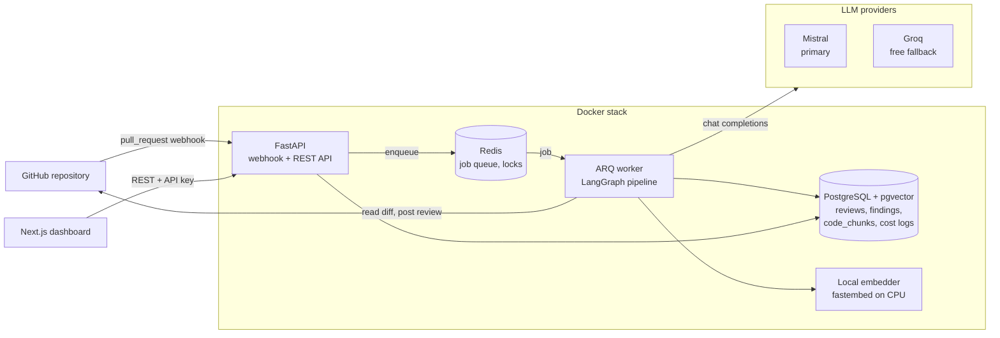
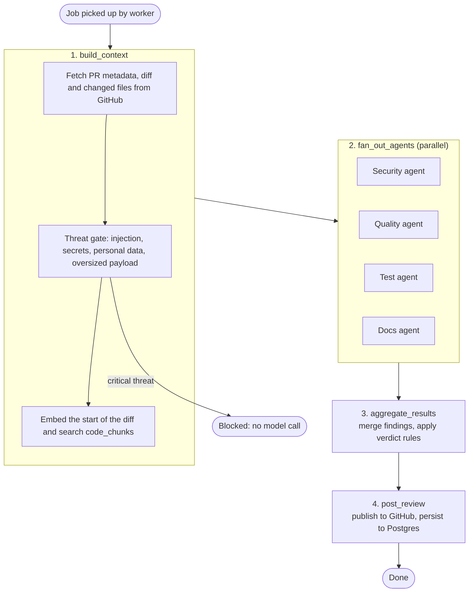
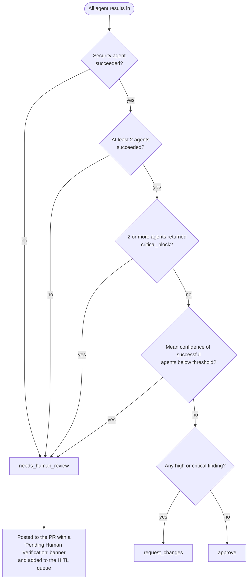
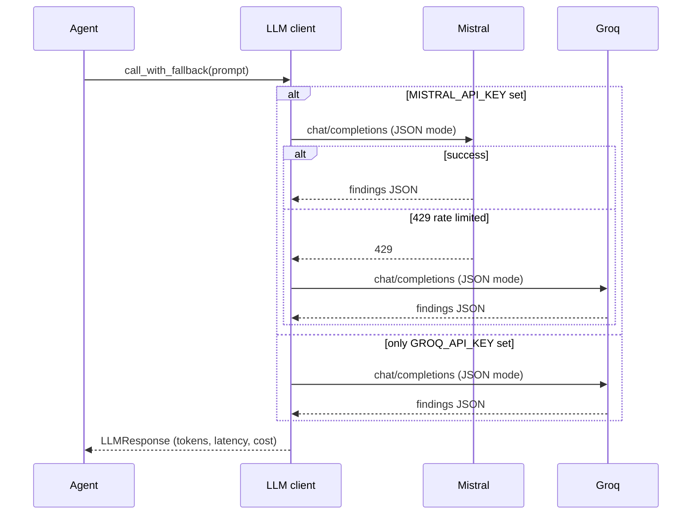

# AI PR Review Agent

A self-hosted service that reviews GitHub pull requests with four specialist AI agents. Each agent looks at one concern: security, code quality, tests, or docs. When a PR is opened or updated, GitHub calls a webhook. The service fetches the diff, pulls related code from the repository's vector index, and runs the four agents in parallel. It merges their findings into one verdict and posts a review on the PR. Reviews the system is unsure about are still posted, marked as pending, and placed in a queue for a person to confirm.

All of it runs on free tiers. Mistral is the main model, Groq is the free backup, and embeddings run locally on your CPU with no API key.

---

## Contents

- [What it does](#what-it-does)
- [Architecture](#architecture)
- [The review pipeline](#the-review-pipeline)
- [How the verdict is decided](#how-the-verdict-is-decided)
- [Models and cost](#models-and-cost)
- [Codebase memory (RAG)](#codebase-memory-rag)
- [Tech stack](#tech-stack)
- [Getting started](#getting-started)
- [API reference](#api-reference)
- [Configuration](#configuration)
- [Testing](#testing)
- [Project layout](#project-layout)
- [Troubleshooting](#troubleshooting)

---

## What it does

| Capability | How |
|---|---|
| Specialist review | Four agents (security, quality, test, docs), each with its own prompt, context budget and verdict |
| Safe intake | HMAC-SHA256 webhook signature check, plus duplicate-delivery protection in Redis |
| Input guard | Each diff is scanned for prompt injection, secrets and personal data before any model sees it. Critical attacks are blocked |
| Codebase grounding | Similar code from the same repo is pulled from pgvector and added to the agents' context |
| Human in the loop | Low-confidence or high-risk reviews are posted with a warning banner and queued for a person to confirm |
| Cost control | Every LLM call is logged with tokens, latency and cost. A daily cap stops runaway spend |
| Reliability | Retries with backoff, circuit breakers on external calls, and a timeout for each workflow |
| Dashboard | Next.js UI for reviews, the HITL queue, spend and service health |

---

## Architecture



The API process only accepts and validates webhooks. It acknowledges them quickly so GitHub doesn't retry, and leaves the slow work to the worker. The worker runs the review graph, calls the models, and writes everything to Postgres.

---

## The review pipeline

The worker runs a four-node LangGraph state machine:



Each agent gets the sanitized diff cut down to its own token budget, plus the retrieved code. It returns findings as JSON with a severity, file, line range and confidence score. A shared output guard repairs or rejects malformed JSON. When an agent's output can't be parsed, it reports low confidence, which pushes the review toward human review.

| Agent | Looks for | Diff budget (tokens) |
|---|---|---|
| Security | Hardcoded secrets (regex pass first), injection, XSS, auth flaws, risky dependencies | 8,000 |
| Quality | Complexity, duplication, naming, consistency with the rest of the repo | 6,000 |
| Test | Missing tests for new branches, unhandled edge cases, regression risk | 5,000 |
| Docs | Undocumented public APIs, env vars and schemas, stale docstrings | 4,000 |

---

## How the verdict is decided

`aggregate_results` applies these rules in order. The first match wins:



- The confidence threshold is `CONFIDENCE_THRESHOLD` (default `0.7`).
- One agent flagging something critical leads to `request_changes`, not human review. Requiring two agents to agree cuts down false alarms.
- A review that needs a human is still posted right away, so the PR author gets feedback without waiting. A reviewer then confirms or overrides it through the HITL API or the dashboard.

---

## Models and cost

| Role | Provider | Default model | Key | Cost |
|---|---|---|---|---|
| Primary LLM | Mistral | `mistral-small-latest` | `MISTRAL_API_KEY` | Mistral's free plan or pay-as-you-go |
| Fallback LLM | Groq | `llama-3.3-70b-versatile` | `GROQ_API_KEY` | Free plan, no card needed |
| Embeddings | Local (fastembed) | `jinaai/jina-embeddings-v2-base-code` | none | Free, runs on your CPU |

### Fallback behaviour



- **Groq only:** leave `MISTRAL_API_KEY` empty and set `GROQ_API_KEY`. Every agent then runs on Groq.
- **Pick another Groq model:** set `FALLBACK_LLM_MODEL` to any Groq chat model ID, for example `llama-3.1-8b-instant` or `openai/gpt-oss-20b`.
- **Groq retries:** the client waits for Groq's `retry-after` header on a 429 (capped at 60 s) and backs off on 5xx errors. It fails right away on other 4xx errors such as a bad key or an oversized request, because retrying can't fix those.
- **Free-plan limits:** Groq's free plan caps each model's requests and tokens per minute and per day. The exact numbers are on the limits page of your Groq console. The security agent sends the largest prompts, so on a strict per-minute cap it's the first to hit a `413` (see [Troubleshooting](#troubleshooting)).
- **Cost numbers:** the dashboard prices Groq calls at Groq's on-demand list rates, so you can see what a call would cost on a paid plan. Calls on the free plan aren't billed.

---

## Codebase memory (RAG)

Agents review a diff better when they can see how the rest of the repo does things. The indexer stores each source file as a vector in the `code_chunks` table. At review time, the start of the diff is embedded and the closest files are added to the prompt.

```mermaid
flowchart TB
    subgraph Index["Indexing (scripts/index-repo.py, or on demand)"]
        direction LR
        I1[List repo files via GitHub API] --> I2[Keep source files only]
        I2 --> I3{SHA changed since<br/>last index?}
        I3 -- no --> I4[Skip]
        I3 -- yes --> I5[Fetch content] --> I6[Embed locally<br/>768-dim vector] --> I7[(code_chunks<br/>pgvector HNSW)]
    end

    subgraph Review["At review time"]
        direction LR
        R1[First 2,000 chars of diff] --> R2[Embed locally] --> R3[Semantic + keyword search<br/>same repo only]
        R3 --> R4[Context block in agent prompts]
    end

    I7 -. nearest neighbours .-> R3
```



- **One file per chunk.** Files longer than 8,000 characters are cut from the end, which keeps the imports and signatures at the top.
- **Only changed files are re-embedded.** The `repo_file_index` table remembers each file's SHA.
- **Embeddings are local.** [fastembed](https://github.com/qdrant/fastembed) runs the ONNX model on CPU in a worker thread, so the event loop stays responsive. The default model is trained on code and outputs 768 values, which matches `VECTOR(768)` in the schema. The first run downloads about 0.6 GB once. Docker keeps the download in the `embedding_models` volume.
- **Faster option:** `EMBEDDING_MODEL=BAAI/bge-base-en-v1.5` is also 768-dim and several times faster on CPU. It only reads about the first 512 tokens of each file.
- **Changing the model:** vectors from different models can't be compared with each other. After you change `EMBEDDING_MODEL`, clear the index and rebuild it (see [Troubleshooting](#troubleshooting)).
- **RAG is optional.** If embedding or search fails, the review runs without the extra context and never fails because of it.

---

## Tech stack

| Layer | Technology |
|---|---|
| API | FastAPI, Uvicorn (Python 3.10+) |
| Orchestration | LangGraph |
| Jobs | ARQ on Redis |
| Database | PostgreSQL 16 with pgvector (TimescaleDB hypertables for event data where available) |
| LLMs | Mistral (primary), Groq (fallback), both over HTTPS with `httpx` |
| Embeddings | fastembed (ONNX Runtime, CPU) |
| Observability | OpenTelemetry traces, structured JSON logs, JSONL audit log, optional Sentry |
| Frontend | Next.js 14, React 18, SWR, Tailwind CSS |
| Packaging | `uv` (`pyproject.toml` + `uv.lock`), Docker Compose |

---

## Getting started

### Prerequisites

- Docker and Docker Compose
- A GitHub repository you can add webhooks to, and a personal access token with `contents:read` and `pull_requests:read+write`
- A Groq API key, free from [console.groq.com/keys](https://console.groq.com/keys)
- Optional: a Mistral API key from [console.mistral.ai](https://console.mistral.ai). Without one, Groq handles every call.
- A tunnel such as ngrok, so GitHub can reach your machine

### 1. Configure

```bash
cp .env.example .env
```

Fill in at least:

```ini
GITHUB_WEBHOOK_SECRET=<openssl rand -hex 32>
GITHUB_TOKEN=<personal access token>
GROQ_API_KEY=<groq key>
MISTRAL_API_KEY=<mistral key, or leave empty for Groq only>
API_KEY=<openssl rand -hex 32>
```

### 2. Start the stack

All local, with Postgres, Redis, Qdrant, the API and the worker:

```bash
docker compose -f docker-compose.dev.yml up -d --build
curl http://localhost:8001/health
```

To use a hosted Postgres instead, put its URL in `DATABASE_URL` and run `docker compose up -d --build`. That starts only Redis, the API and the worker.

Interactive API docs are served at `http://localhost:8001/docs`. The API creates its tables and the vector schema on startup.

### 3. Index the repository (recommended)

```bash
docker compose -f docker-compose.dev.yml exec api python3 scripts/index-repo.py <owner/repo>
```

The first run downloads the embedding model, so it takes longer than later runs.

### 4. Connect GitHub

```bash
ngrok http 8001
```

In the repository, go to **Settings → Webhooks → Add webhook**:

- **Payload URL:** `https://<your-tunnel>/webhook/github`
- **Content type:** `application/json`
- **Secret:** the value of `GITHUB_WEBHOOK_SECRET`
- **Events:** choose individual events, then **Pull requests**

Open or update a PR. The review appears on it when the worker finishes.

### 5. Dashboard (optional)

```bash
cd frontend
cp .env.local.example .env.local   # set NEXT_PUBLIC_API_BASE_URL=http://localhost:8001 and NEXT_PUBLIC_API_KEY
npm install
npm run dev                        # http://localhost:3000
```

### Other ways to trigger a review

```bash
# Review an existing open PR without a webhook
docker compose -f docker-compose.dev.yml exec api python3 scripts/trigger-pr-review.py <owner/repo> <pr_number>

# End-to-end demo: signs and sends the sample webhook in fixtures/, then polls for the verdict
bash scripts/demo.sh
```

---

## API reference

All `/api/v1/*` routes need the `X-API-Key` header in production.

| Method | Path | Purpose |
|---|---|---|
| POST | `/webhook/github` | GitHub webhook receiver (HMAC-verified) |
| GET | `/health/live` | Liveness probe |
| GET | `/health` | Readiness: Postgres, Redis, vector memory, circuit breakers |
| GET | `/api/v1/reviews` | List reviews |
| GET | `/api/v1/reviews/{id}` | One review with its findings |
| GET | `/api/v1/queue` | Reviews in progress or waiting for human approval |
| GET | `/api/v1/hitl/queue` | Reviews waiting for a human (`?repo=` filter) |
| GET | `/api/v1/hitl/{hitl_id}` | One HITL item |
| POST | `/api/v1/hitl/{hitl_id}/decision` | Record a human verdict |
| POST | `/api/v1/hitl/queue/rebuild` | Rebuild the Redis queue from Postgres |
| GET | `/api/v1/economics/summary` | Spend and token totals |
| GET | `/api/v1/economics/budget` | Today's spend against the daily cap |
| GET | `/api/v1/economics/timeseries` | Daily spend series |
| GET | `/api/v1/economics/workflow/{workflow_id}` | Cost breakdown of one review |
| GET | `/api/v1/economics/agent-health` | Per-agent cost, p95 latency and rejection rate |
| GET | `/api/v1/economics/pr-cost/{review_id}` | Cost of one PR review |
| GET | `/api/v1/economics/daily-summary` | Last 24 h cost and latency |

Example human decision:

```bash
curl -X POST http://localhost:8001/api/v1/hitl/<hitl_id>/decision \
  -H "X-API-Key: $API_KEY" -H "Content-Type: application/json" \
  -d '{"human_verdict": "approve", "reason": "Findings checked, acceptable here.", "reviewer_id": "reviewer-1"}'
```

---

## Configuration

Every setting is an environment variable, read from `.env` (see `.env.example`). The main ones:

| Variable | Default | Meaning |
|---|---|---|
| `GITHUB_WEBHOOK_SECRET` | required | Shared secret for webhook signatures |
| `GITHUB_TOKEN` | required | Token used to read PRs and post reviews |
| `MISTRAL_API_KEY` | empty | Primary model key. Leave empty to run on Groq only |
| `GROQ_API_KEY` | empty | Fallback model key (free plan) |
| `FALLBACK_LLM_MODEL` | `llama-3.3-70b-versatile` | Groq model used for the fallback |
| `SECURITY_MODEL`, `QUALITY_MODEL`, `TEST_MODEL`, `DOCS_MODEL` | `mistral-small-latest` | Mistral model for each agent |
| `EMBEDDING_MODEL` | `jinaai/jina-embeddings-v2-base-code` | Local embedding model (must be 768-dim) |
| `EMBEDDING_CACHE_DIR` | system temp folder | Where model files are cached (`/models` in Docker) |
| `DATABASE_URL` | local Postgres | `postgresql+asyncpg://...` |
| `REDIS_URL` | `redis://localhost:6379/0` | Redis for jobs and locks |
| `CONFIDENCE_THRESHOLD` | `0.7` | Below this mean confidence, the review goes to a human |
| `DAILY_BUDGET_USD` | `50.0` | Hard daily cap on estimated LLM spend |
| `WORKFLOW_TIMEOUT_SECONDS` | `300` | A review that runs longer is stopped and marked timed out |
| `MAX_CONCURRENT_REVIEWS` | `3` | Reviews the worker runs at once |
| `API_KEY` | required in production | Key for `/api/v1/*` |

---

## Testing

Tests run offline. HTTP calls are mocked, and the embedding model is swapped for a small fake so nothing is downloaded.

```bash
uv sync --extra dev
uv run pytest tests/
```

| File | Covers |
|---|---|
| `tests/test_groq_and_local_embeddings.py` | Groq requests, retries, Mistral to Groq fallback, local embedder |
| `tests/test_phase5.py` | Agent prompt building, output guard, model routing |
| `tests/test_phase8.py`, `test_phase8b.py` | Aggregation rules and review posting |
| `tests/test_phase11.py` | Threat gate, masking, injection detection |
| `tests/test_eval_*.py` | Golden-dataset evaluation and regression gate |

To run the embedding tests against the real model:

```bash
RUN_REAL_EMBEDDINGS=1 uv run pytest tests/test_groq_and_local_embeddings.py
```

---

## Project layout

```
backend/
├── agents/            Security, quality, test and docs agents + shared base and contracts
├── api/               REST routers: reviews, queue, HITL, economics
├── auth/              API-key dependency
├── config/            Settings (pydantic-settings)
├── core/              Workflow engine and exceptions
├── data/              Repository ingestion and freshness tracking
├── database/          SQLAlchemy models, Postgres engine, repositories
├── economics/         Budget guard, cost logging, routing advisor
├── evaluation/        Golden dataset, LLM judge, regression gate
├── hitl/              Human review queue, escalation, disputes, feedback
├── integrations/      GitHub REST client and models
├── job_queue/         ARQ worker
├── memory/            Local embedder, pgvector client, Redis client
├── models/            Pydantic models and enums
├── observability/     Logging, tracing, audit log, alerts
├── orchestrator/      LangGraph graph, nodes and state
├── prompts/           Versioned prompt templates per agent
├── reliability/       Retry, timeout, circuit breaker, idempotency
├── security/          Threat model, masking, RBAC
├── tools/             LLM client, model router, sandbox, tool registry
└── webhook_receiver/  Signature check, payload parsing, enqueue
frontend/              Next.js dashboard
docs/adr/              Architecture decision records
scripts/               Indexer, manual trigger, demo, SQL migrations
tests/                 Test suite
```

---

## Troubleshooting

**Groq returns `413 Request too large`.** The prompt is bigger than the model's tokens-per-minute limit on your plan. Lower that agent's context budget in `backend/tools/model_router.py`, or set `FALLBACK_LLM_MODEL` to a model with a higher limit.

**Groq returns `429` often.** You're hitting the free plan's per-minute or per-day cap. Lower `MAX_CONCURRENT_REVIEWS`, add a Mistral key so Groq is only the backup, or check your limits in the Groq console.

**The first review or index run is slow.** The embedding model is downloading (about 0.6 GB, once). Later runs load it from `EMBEDDING_CACHE_DIR`.

**Retrieved context looks unrelated after changing the embedding model.** Vectors from the old model are still stored. Clear them and re-index:

```sql
TRUNCATE code_chunks;
TRUNCATE repo_file_index;
```

```bash
python3 scripts/index-repo.py <owner/repo>
```

**The embedder reports a dimension mismatch.** The chosen `EMBEDDING_MODEL` doesn't output 768 values. Pick a 768-dim model, or change `VECTOR(768)` in `scripts/migrations/2026-06-vector-init.sql` and `EMBEDDING_DIMENSIONS` in `backend/memory/embedder.py` together.
